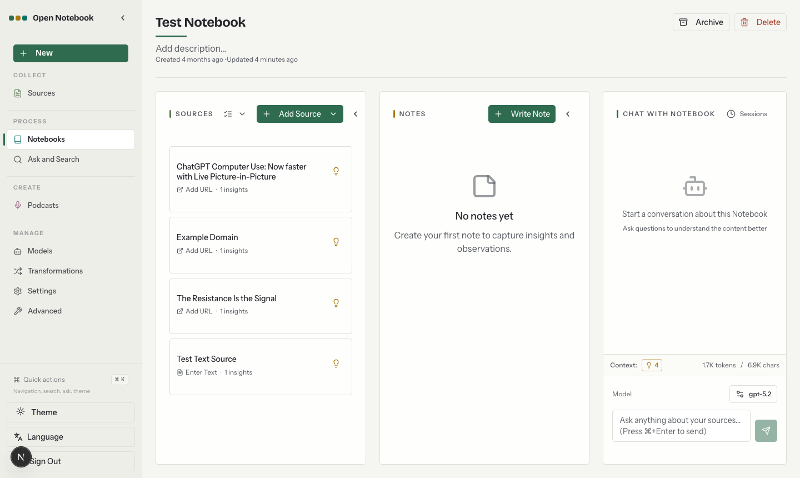

<a id="readme-top"></a>

<!-- [![Contributors][contributors-shield]][contributors-url] -->
[![Forks][forks-shield]][forks-url]
[![Stargazers][stars-shield]][stars-url]
[![Issues][issues-shield]][issues-url]
[![MIT License][license-shield]][license-url]
<!-- [![LinkedIn][linkedin-shield]][linkedin-url] -->


<!-- PROJECT LOGO -->
<br />
<div align="center">
  <a href="https://github.com/lfnovo/open-notebook">
    
  </a>

  <h3 align="center">Open Notebook</h3>

  <p align="center">
    بديل مفتوح المصدر يركّز على الخصوصية لـ Notebook LM من Google!
    <br /><strong>انضم إلى <a href="https://discord.gg/37XJPXfz2w">خادم Discord</a> الخاص بنا للحصول على المساعدة ومشاركة أفكار سير العمل واقتراح الميزات!</strong>
    <br />
    <a href="https://www.open-notebook.ai"><strong>تفضّل بزيارة موقعنا »</strong></a>
    <br />
    تابِع <a href="https://x.com/lfnovo"><span dir="ltr">@lfnovo</span> على X</a> للاطلاع على آخر المستجدات
    <br />
    <br />
    <a href="../../0-START-HERE/index.md">📚 ابدأ الآن</a>
    ·
    <a href="../../3-USER-GUIDE/index.md">📖 دليل المستخدم</a>
    ·
    <a href="../../2-CORE-CONCEPTS/index.md">✨ الميزات</a>
    ·
    <a href="../../1-INSTALLATION/index.md">🚀 النشر</a>
  </p>
</div>

<p align="center">
<a href="https://trendshift.io/repositories/14536" target="_blank"></a>
</p>

<div align="center">
  <a href="../../../README.md">English</a> | 
  <a href="https://zdoc.app/de/lfnovo/open-notebook">Deutsch</a> | 
  <a href="https://zdoc.app/es/lfnovo/open-notebook">Español</a> | 
  <a href="https://zdoc.app/fr/lfnovo/open-notebook">français</a> | 
  <a href="https://zdoc.app/ja/lfnovo/open-notebook">日本語</a> | 
  <a href="https://zdoc.app/ko/lfnovo/open-notebook">한국어</a> | 
  <a href="https://zdoc.app/pt/lfnovo/open-notebook">Português</a> | 
  <a href="https://zdoc.app/ru/lfnovo/open-notebook">Русский</a> | 
  <a href="https://zdoc.app/zh/lfnovo/open-notebook">中文</a>
</div>

<div dir="rtl">

> 🌐 تمت ترجمة هذا المستند من الإصدار `5e285b7` من ملف [README](../../../README.md) الإنجليزي. للاطلاع على أحدث المعلومات، راجع النسخة الإنجليزية.

</div>

<div dir="rtl">

## بديل خاص ومتعدد النماذج ومحلي بنسبة 100% وكامل الميزات لـ Notebook LM



في عالمٍ يهيمن عليه الذكاء الاصطناعي، تصبح القدرة على التفكير 🧠 واكتساب المعرفة الجديدة 💡 مهارةً لا ينبغي أن تكون امتيازًا لقلّة من الناس، ولا أن تكون حكرًا على مزوّد واحد.

**مع Open Notebook يمكنك:**
- 🔒 **التحكم في بياناتك** - حافظ على خصوصية أبحاثك وأمانها
- 🤖 **اختيار نماذج الذكاء الاصطناعي** - أكثر من 20 مزوّدًا، منها OpenAI وAnthropic وGoogle وMistral وOllama، وأي خادم متوافق مع OpenAI (مثل LM Studio وvLLM)
- 📚 **تنظيم محتوى متعدد الوسائط** - ملفات PDF ومقاطع الفيديو والملفات الصوتية وصفحات الويب وغيرها
- 🎙️ **إنشاء بودكاست احترافي** - توليد متقدم لحلقات بودكاست متعددة المتحدثين
- 🔍 **البحث بذكاء** - بحث نصي كامل وبحث متّجهي في كل محتواك
- 💬 **الدردشة مع مراعاة السياق** - محادثات ذكاء اصطناعي تستند إلى أبحاثك
- 🌐 **واجهة متعددة اللغات** - الإنجليزية والبنغالية والكتالونية والصينية (المبسّطة والتقليدية) والفرنسية والألمانية والإيطالية واليابانية والبولندية والبرتغالية والروسية والإسبانية والتركية

تعرّف على المزيد عن مشروعنا عبر [https://www.open-notebook.ai](https://www.open-notebook.ai)

---

## مقارنة: Open Notebook 🆚 Google Notebook LM

| الخاصية | Open Notebook | Google Notebook LM | الأفضلية |
|---------|---------------|--------------------|-----------|
| **الخصوصية والتحكم** | استضافة ذاتية، وبياناتك ملكك | سحابة Google فقط | سيادة كاملة على البيانات |
| **اختيار مزوّد الذكاء الاصطناعي** | أكثر من 20 مزوّدًا، سحابيًا أو محليًا (OpenAI وAnthropic وGoogle وOllama وLM Studio وغيرها) | نماذج Google فقط | المرونة وتحسين التكلفة |
| **متحدثو البودكاست** | من 1 إلى 4 متحدثين بملفات تعريف مخصّصة | متحدثان فقط | مرونة فائقة |
| **تحويلات المحتوى** | مخصّصة ومدمجة | خيارات محدودة | قدرة معالجة غير محدودة |
| **الوصول عبر API** | واجهة REST API كاملة | لا توجد API | أتمتة كاملة |
| **النشر** | Docker أو السحابة أو محليًا | مستضاف لدى Google فقط | انشره في أي مكان |
| **الاستشهادات** | تستشهد الإجابات بالمصادر والملاحظات والرؤى التي استندت إليها | شاملة مع المصادر | نزاهة البحث |
| **التخصيص** | مفتوح المصدر وقابل للتخصيص بالكامل | نظام مغلق | قابلية توسّع غير محدودة |
| **التكلفة** | تدفع فقط مقابل استخدام الذكاء الاصطناعي | فئة مجانية + اشتراك شهري | تكلفة شفافة يمكن التحكم فيها |

**لماذا تختار Open Notebook؟**
- 🔒 **الخصوصية أولًا**: تبقى أبحاثك الحساسة خاصة تمامًا
- 💰 **التحكم في التكلفة**: اختر مزوّدي ذكاء اصطناعي أقل تكلفة، أو شغّل النماذج محليًا باستخدام Ollama
- 🎙️ **بودكاست أفضل**: تحكّم كامل في النص ومرونة في تعدد المتحدثين، بدلًا من صيغة "deep-dive" المحدودة بمتحدثَين اثنين
- 🔧 **تخصيص بلا حدود**: عدّله ووسّعه وادمجه مع أدواتك حسب حاجتك
- 🌐 **لا ارتباط بمزوّد واحد**: بدّل المزوّدين، وانشره في أي مكان، وامتلك بياناتك

### التقنيات المستخدمة

[![Python][Python]][Python-url] [![Next.js][Next.js]][Next-url] [![React][React]][React-url] [![SurrealDB][SurrealDB]][SurrealDB-url] [![LangChain][LangChain]][LangChain-url]

## 🚀 البدء السريع

### المتطلبات
- تطبيق [Docker Desktop](https://www.docker.com/products/docker-desktop/) (على macOS وWindows)، أو Docker Engine مع إضافة Compose (على Linux)
- مفتاح API من أحد مزوّدي الذكاء الاصطناعي، أو خادم نماذج محلي مثل Ollama. تضيف المفتاح من خلال الواجهة، لا في ملفات الإعداد.

### الخطوة 1: نزّل ملف docker-compose.yml

</div>

```bash
mkdir open-notebook && cd open-notebook
curl -o docker-compose.yml https://raw.githubusercontent.com/lfnovo/open-notebook/main/docker-compose.yml
```

<div dir="rtl">

هذا هو ملف [docker-compose.yml](../../../docker-compose.yml) الرسمي في هذا المستودع. وهو يشغّل خدمتين: `surrealdb` (قاعدة البيانات) و`open_notebook` (واجهة المستخدم وواجهة API وعامل المهام في الخلفية).

### الخطوة 2: عيّن مفتاح التشفير
عدّل ملف `docker-compose.yml` وغيّر هذا السطر:

</div>

```yaml
- OPEN_NOTEBOOK_ENCRYPTION_KEY=change-me-to-a-secret-string
```

<div dir="rtl">

إلى قيمة سرية طويلة وعشوائية تولّدها بنفسك (مثلًا باستخدام `openssl rand -hex 32`؛ أو [خيارات أخرى](../../1-INSTALLATION/docker-compose.md#step-2-set-your-encryption-key)). يُشفِّر هذا المفتاح مفاتيح API التي تخزّنها، فاحتفظ به.

> **شبكة مشتركة أو خادم؟** يُنشَر منفذا واجهة المستخدم (`8502`) وواجهة API (`5055`) على جميع واجهات الشبكة، ولا توجد كلمة مرور افتراضيًا. إذا كان بإمكان أجهزة أخرى الوصول إلى هذا الجهاز، فقبل التشغيل غيّر سطرَي المنفذين هذين إلى `"127.0.0.1:8502:8502"` و`"127.0.0.1:5055:5055"`، أو أضف <code dir="ltr">- OPEN_NOTEBOOK_PASSWORD=your-password</code> إلى كتلة <code dir="ltr">environment:</code>.

### الخطوة 3: شغّل الخدمات

</div>

```bash
docker compose up -d
```

<div dir="rtl">

انتظر نحو 30 ثانية، ثم افتح: **http://localhost:8502**

### الخطوة 4: اربط مزوّد ذكاء اصطناعي
1. افتح **Models** من الشريط الجانبي (ضمن Manage).
2. ابحث عن مزوّدك (OpenAI أو Anthropic أو Google أو غيرها) وانقر على **Add Configuration**.
3. أدخل اسمًا ومفتاح API الخاص بك (تحتاج المزوّدات المحلية مثل Ollama إلى **Base URL** بدلًا منه)، ثم انقر على **Add Configuration**.
4. انقر على **Test** في الإعداد الجديد للتحقق من الاتصال.
5. انقر على **Models**، واختر **Model Type**، وحدّد النماذج التي تريد إضافتها، ثم انقر على **Add**. أضف نموذجًا واحدًا على الأقل من نوع **Language** ونموذجًا واحدًا من نوع **Embedding**.
6. ضمن **Default Model Assignments**، انقر على **Auto-assign Defaults** (أو اختر النماذج بنفسك).

تم! أنشئ دفتر ملاحظات، وأضف مصدرًا، وابدأ الدردشة. الشرح الكامل: [ربط مزوّد](../../4-AI-PROVIDERS/index.md#connect-a-provider).

> **تحتاج إلى مفتاح API؟** احصل عليه من:
> [OpenAI](https://platform.openai.com/api-keys) · [Anthropic](https://console.anthropic.com/settings/keys) · [Google](https://aistudio.google.com/app/apikey) · [Groq](https://console.groq.com/keys)
>
> لا توفّر Anthropic وGroq نماذج تضمين (embedding)، لذا استخدمهما مع مزوّد يوفّرها (راجع [الجدول](#provider-support-matrix)).

> **تريد ذكاءً اصطناعيًا محليًا ومجانيًا؟** راجع [دليل البدء السريع المحلي](../../0-START-HERE/quick-start-local.md) (Ollama داخل Docker).

---

### 📚 خيارات تثبيت أخرى

- **[ذكاء اصطناعي محلي مع Ollama](../../0-START-HERE/quick-start-local.md)** - شغّل النماذج محليًا دون تكاليف API
- **[دليل Docker Compose](../../1-INSTALLATION/docker-compose.md)** - الإعدادات والنسخ الاحتياطي والتحديثات والوصول عن بُعد
- **[التثبيت من المصدر (للمطورين)](../../1-INSTALLATION/from-source.md)** - للتطوير والمساهمة
- **[دليل التثبيت الشامل](../../1-INSTALLATION/index.md)** - جميع سيناريوهات النشر

---

### 📖 هل تحتاج إلى مساعدة؟

- **🤖 مساعد التثبيت بالذكاء الاصطناعي**: [CustomGPT يساعدك في التثبيت](https://chatgpt.com/g/g-68776e2765b48191bd1bae3f30212631-open-notebook-installation-assistant)
- **🆘 استكشاف الأخطاء وإصلاحها**: [دليل استكشاف الأخطاء وإصلاحها في 5 دقائق](../../6-TROUBLESHOOTING/quick-fixes.md)
- **💬 دعم المجتمع**: [خادم Discord](https://discord.gg/37XJPXfz2w)
- **🐛 الإبلاغ عن المشكلات**: [GitHub Issues](https://github.com/lfnovo/open-notebook/issues)

---

## سجل النجوم

[](https://star-history.dera.page/#lfnovo/open-notebook&type=date&legend=top-left)

</div>

<a id="provider-support-matrix"></a>
<div dir="rtl">

## جدول دعم المزوّدين

بفضل مكتبة [Esperanto](https://github.com/lfnovo/esperanto)، ندعم المزوّدين التاليين مباشرةً دون أي إعداد إضافي. تُظهر الأعمدة أنواع النماذج التي يقدّمها كل مزوّد، أما ما يمكنك استخدامه فعليًا فيعتمد على حسابك.

| المزوّد      | دعم LLM | دعم Embedding | تحويل الكلام إلى نص | تحويل النص إلى كلام |
|--------------|-------------|------------------|----------------|----------------|
| OpenAI       | ✅          | ✅               | ✅             | ✅             |
| Anthropic    | ✅          | ❌               | ❌             | ❌             |
| Google (GenAI) | ✅          | ✅               | ✅             | ✅             |
| Groq         | ✅          | ❌               | ✅             | ❌             |
| Mistral      | ✅          | ✅               | ✅             | ✅             |
| DeepSeek     | ✅          | ❌               | ❌             | ❌             |
| xAI          | ✅          | ❌               | ❌             | ✅             |
| OpenRouter   | ✅          | ✅               | ✅             | ✅             |
| DashScope (Qwen) | ✅          | ❌               | ❌             | ❌             |
| MiniMax      | ✅          | ❌               | ❌             | ✅             |
| Novita       | ✅          | ❌               | ❌             | ❌             |
| SiliconFlow  | ✅          | ❌               | ❌             | ❌             |
| Z.ai         | ✅          | ❌               | ❌             | ❌             |
| PayPerQ (PPQ) | ✅          | ✅               | ✅             | ✅             |
| Cohere       | ✅          | ✅               | ❌             | ❌             |
| Voyage       | ❌          | ✅               | ❌             | ❌             |
| ElevenLabs   | ❌          | ❌               | ✅             | ✅             |
| Deepgram     | ❌          | ❌               | ✅             | ✅             |
| Ollama       | ✅          | ✅               | ❌             | ❌             |
| oMLX         | ✅          | ✅               | ❌             | ❌             |
| Azure OpenAI | ✅          | ✅               | ✅             | ✅             |
| Vertex AI    | ✅          | ✅               | ❌             | ✅             |
| <span dir="ltr">OpenAI Compatible*</span> | ✅          | ✅               | ✅             | ✅             |
| Anthropic Compatible | ✅          | ❌               | ❌             | ❌             |

*يدعم LM Studio وأي نقطة نهاية (endpoint) متوافقة مع OpenAI. ويُفضَّل استخدام مزوّد **oMLX** الأصلي مع [oMLX](https://omlx.ai/) (على Apple Silicon)؛ راجع [docs/5-CONFIGURATION/omlx.md](../../5-CONFIGURATION/omlx.md).

## ✨ الميزات الرئيسية

### القدرات الأساسية
- **🔒 الخصوصية أولًا**: استضافة ذاتية، ومع النماذج المحلية لا يغادر أي شيء جهازك
- **🎯 تنظيم دفاتر متعددة**: أدِر عدة مشاريع بحثية بسلاسة
- **📚 دعم شامل للمحتوى**: ملفات PDF ومقاطع الفيديو والملفات الصوتية وصفحات الويب ومستندات Office وغيرها
- **🤖 دعم نماذج ذكاء اصطناعي متعددة**: أكثر من 20 مزوّدًا، منها OpenAI وAnthropic وOllama وGoogle وLM Studio وغيرها
- **🎙️ إنشاء بودكاست احترافي**: حلقات بودكاست متقدمة متعددة المتحدثين باستخدام Episode Profiles
- **🔍 بحث ذكي**: بحث نصي كامل وبحث متّجهي في كل محتواك
- **💬 دردشة واعية بالسياق**: محادثات ذكاء اصطناعي تستند إلى موادك البحثية
- **📝 ملاحظات بمساعدة الذكاء الاصطناعي**: ولّد رؤى جديدة أو اكتب ملاحظاتك يدويًا

### الميزات المتقدمة
- **⚡ دعم نماذج الاستدلال**: دعم كامل لنماذج التفكير مثل DeepSeek-R1 وQwen3
- **🔧 تحويلات المحتوى**: إجراءات قوية قابلة للتخصيص لتلخيص المحتوى واستخلاص الرؤى
- **🌐 واجهة REST API شاملة**: وصول برمجي كامل لعمليات التكامل المخصّصة [](http://localhost:5055/docs)
- **🔐 حماية اختيارية بكلمة مرور**: أمّن عمليات النشر العامة بالمصادقة
- **📊 تحكم دقيق في السياق**: اختر بدقة ما تشاركه مع نماذج الذكاء الاصطناعي
- **📎 الاستشهادات**: احصل على إجابات مع استشهادات صحيحة بمصادرها


## ميزة البودكاست

[](https://www.youtube.com/watch?v=D-760MlGwaI)

## 📚 التوثيق

### البدء
- **[📖 مقدمة](../../0-START-HERE/index.md)** - تعرّف على ما يقدّمه Open Notebook
- **[⚡ البدء السريع مع مزوّد سحابي](../../0-START-HERE/quick-start-cloud.md)** - OpenAI وAnthropic وGoogle وغيرها في 5 دقائق
- **[🔧 التثبيت](../../1-INSTALLATION/index.md)** - دليل إعداد شامل
- **[🎯 تشغيله محليًا بالكامل](../../0-START-HERE/quick-start-local.md)** - Ollama/LM Studio، بخصوصية تامة

### دليل المستخدم
- **[📱 نظرة عامة على الواجهة](../../3-USER-GUIDE/interface-overview.md)** - فهم تخطيط الواجهة
- **[📚 الدفاتر والمصادر والملاحظات](../../2-CORE-CONCEPTS/notebooks-sources-notes.md)** - تنظيم أبحاثك
- **[📄 إضافة المصادر](../../3-USER-GUIDE/adding-sources.md)** - إدارة أنواع المحتوى
- **[📝 العمل مع الملاحظات](../../3-USER-GUIDE/working-with-notes.md)** - إنشاء الملاحظات وإدارتها
- **[💬 الدردشة بفعالية](../../3-USER-GUIDE/chat-effectively.md)** - محادثات الذكاء الاصطناعي
- **[🔍 البحث](../../3-USER-GUIDE/search.md)** - العثور على المعلومات

### مواضيع متقدمة
- **[🎙️ إنشاء البودكاست](../../2-CORE-CONCEPTS/podcasts-explained.md)** - أنشئ حلقات بودكاست احترافية
- **[🔧 تحويلات المحتوى](../../3-USER-GUIDE/transformations.md)** - خصّص طريقة معالجة المحتوى
- **[🤖 مزوّدو الذكاء الاصطناعي](../../4-AI-PROVIDERS/index.md)** - اربط المزوّدين وعيّن النماذج الافتراضية
- **[🔌 التكامل مع MCP](../../5-CONFIGURATION/mcp-integration.md)** - اتصل بـ Claude Desktop وVS Code وغيرهما من عملاء MCP
- **[🔧 مرجع REST API](../../7-DEVELOPMENT/api-reference.md)** - توثيق كامل لواجهة API
- **[🔐 الأمان](../../5-CONFIGURATION/security.md)** - الحماية بكلمة مرور والخصوصية
- **[🚀 النشر](../../1-INSTALLATION/index.md)** - أدلة نشر كاملة لجميع السيناريوهات
- **[🧭 الرؤية والمبادئ](../../../VISION.md)** - ما هو Open Notebook وإلى أين يتجه
- **[🛠️ توثيق المطورين](../../7-DEVELOPMENT/index.md)** - البنية المعمارية والإعداد والمساهمة وسجلات القرارات

<p align="left">(<a href="#readme-top">العودة إلى الأعلى</a>)</p>

## 🗺️ إلى أين نتجه

ينصبّ تركيزنا حاليًا على جعل التجربة الأساسية (المصادر والدردشة والبحث والملاحظات والبودكاست) متينة مع كل مزوّد وفي كل بيئة نشر، قبل إضافة واجهات جديدة إلى المنتج. أما التوجهات الأكبر قيد الدراسة، مثل دعم تعدد المستخدمين وصيغ المخرجات الجديدة ووكلاء يشغّلون Open Notebook عبر MCP، فهي موصوفة في قسم **Horizon** من ملف [VISION.md](../../../VISION.md#horizon). إنها توجهات، لا وعود بمواعيد محددة.

تصفّح [GitHub Discussions](https://github.com/lfnovo/open-notebook/discussions/categories/ideas) للاطلاع على الميزات المقترحة وأفكار المنتج، و[المشكلات المفتوحة (Issues)](https://github.com/lfnovo/open-notebook/issues) للاطلاع على الأخطاء المعروفة والأعمال المعتمدة. وتجد أحدث التغييرات في [CHANGELOG](../../../CHANGELOG.md).

<p align="left">(<a href="#readme-top">العودة إلى الأعلى</a>)</p>


## 📖 هل تحتاج إلى مساعدة؟
- **🤖 مساعد التثبيت بالذكاء الاصطناعي**: لدينا [CustomGPT مُعدّ لمساعدتك في تثبيت Open Notebook](https://chatgpt.com/g/g-68776e2765b48191bd1bae3f30212631-open-notebook-installation-assistant)، وسيرشدك خطوة بخطوة!
- **جديد على Open Notebook؟** ابدأ بقراءة [دليل البدء](../../0-START-HERE/index.md)
- **تحتاج إلى مساعدة في التثبيت؟** راجع [دليل التثبيت](../../1-INSTALLATION/index.md)
- **تريد رؤيته أثناء العمل؟** جرّب [درس البدء السريع](../../0-START-HERE/index.md)

## 🤝 المجتمع والمساهمة

### انضم إلى المجتمع
- 💬 **[خادم Discord](https://discord.gg/37XJPXfz2w)** - احصل على المساعدة، وشارك أفكارك، وتواصل مع المستخدمين الآخرين
- 𝕏 **[تابِع <span dir="ltr">@lfnovo</span> على X](https://x.com/lfnovo)** - تحديثات المشروع وأخباره من المشرف عليه
- 💡 **[GitHub Discussions](https://github.com/lfnovo/open-notebook/discussions)** - اطرح الأسئلة وشارك في رسم الميزات واتجاه المنتج والتصميم والبنية المعمارية
- 🐛 **[GitHub Issues](https://github.com/lfnovo/open-notebook/issues)** - أبلغ عن الأخطاء القابلة لإعادة الإنتاج، واعثر على الأعمال المعتمدة
- ⭐ **امنح هذا المستودع نجمة** - أظهر دعمك وساعد الآخرين على اكتشاف Open Notebook

### المساهمة
نرحّب بمساهماتكم! ونبحث بشكل خاص عن مساعدة في:
- **تطوير الواجهة الأمامية**: ساعدنا في تحسين واجهتنا الحديثة المبنية بـ Next.js/React
- **الاختبار وإصلاح الأخطاء**: اجعل Open Notebook أكثر متانة
- **تطوير الميزات**: لنبنِ معًا أروع أداة بحثية
- **التوثيق**: حسّن الأدلة والدروس التعليمية

**الحزمة التقنية الحالية**: Python وFastAPI وNext.js وReact وSurrealDB

راجع [دليل المساهمة](../../../CONTRIBUTING.md) للحصول على معلومات مفصّلة حول كيفية البدء، بما في ذلك إرشاداتنا الخاصة بـ[المساهمات المُعدّة بمساعدة الذكاء الاصطناعي](../../7-DEVELOPMENT/contributing.md#ai-assisted-and-agent-generated-prs). ولفهم ما نبنيه (وما سنرفضه)، اقرأ [VISION.md](../../../VISION.md).

<p align="left">(<a href="#readme-top">العودة إلى الأعلى</a>)</p>


## 📄 الترخيص

يخضع Open Notebook لترخيص MIT. راجع ملف [LICENSE](../../../LICENSE) للاطلاع على التفاصيل.


**دعم المجتمع**:
- 💬 [خادم Discord](https://discord.gg/37XJPXfz2w) - احصل على المساعدة، وشارك أفكارك، وتواصل مع المستخدمين
- 𝕏 [تابِع <span dir="ltr">@lfnovo</span> على X](https://x.com/lfnovo) - تحديثات المشروع وأخباره من المشرف عليه
- 💡 [GitHub Discussions](https://github.com/lfnovo/open-notebook/discussions) - اطرح الأسئلة وشارك في صياغة الأفكار
- 🐛 [GitHub Issues](https://github.com/lfnovo/open-notebook/issues) - أبلغ عن الأخطاء القابلة لإعادة الإنتاج، واعثر على الأعمال المعتمدة
- 🌐 [الموقع الإلكتروني](https://www.open-notebook.ai) - تعرّف على المزيد عن المشروع

<p align="left">(<a href="#readme-top">العودة إلى الأعلى</a>)</p>

</div>


<!-- MARKDOWN LINKS & IMAGES -->
<!-- https://www.markdownguide.org/basic-syntax/#reference-style-links -->
[contributors-shield]: https://img.shields.io/github/contributors/lfnovo/open-notebook.svg?style=for-the-badge
[contributors-url]: https://github.com/lfnovo/open-notebook/graphs/contributors
[forks-shield]: https://img.shields.io/github/forks/lfnovo/open-notebook.svg?style=for-the-badge
[forks-url]: https://github.com/lfnovo/open-notebook/network/members
[stars-shield]: https://img.shields.io/github/stars/lfnovo/open-notebook.svg?style=for-the-badge
[stars-url]: https://github.com/lfnovo/open-notebook/stargazers
[issues-shield]: https://img.shields.io/github/issues/lfnovo/open-notebook.svg?style=for-the-badge
[issues-url]: https://github.com/lfnovo/open-notebook/issues
[license-shield]: https://img.shields.io/github/license/lfnovo/open-notebook.svg?style=for-the-badge
[license-url]: https://github.com/lfnovo/open-notebook/blob/main/LICENSE
[linkedin-shield]: https://img.shields.io/badge/-LinkedIn-black.svg?style=for-the-badge&logo=linkedin&colorB=555
[linkedin-url]: https://linkedin.com/in/lfnovo
[Next.js]: https://img.shields.io/badge/Next.js-000000?style=for-the-badge&logo=next.js&logoColor=white
[Next-url]: https://nextjs.org/
[React]: https://img.shields.io/badge/React-61DAFB?style=for-the-badge&logo=react&logoColor=black
[React-url]: https://reactjs.org/
[Python]: https://img.shields.io/badge/Python-3776AB?style=for-the-badge&logo=python&logoColor=white
[Python-url]: https://www.python.org/
[LangChain]: https://img.shields.io/badge/LangChain-3A3A3A?style=for-the-badge&logo=chainlink&logoColor=white
[LangChain-url]: https://www.langchain.com/
[SurrealDB]: https://img.shields.io/badge/SurrealDB-FF5E00?style=for-the-badge&logo=databricks&logoColor=white
[SurrealDB-url]: https://surrealdb.com/
