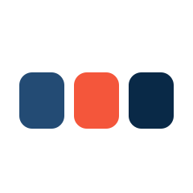
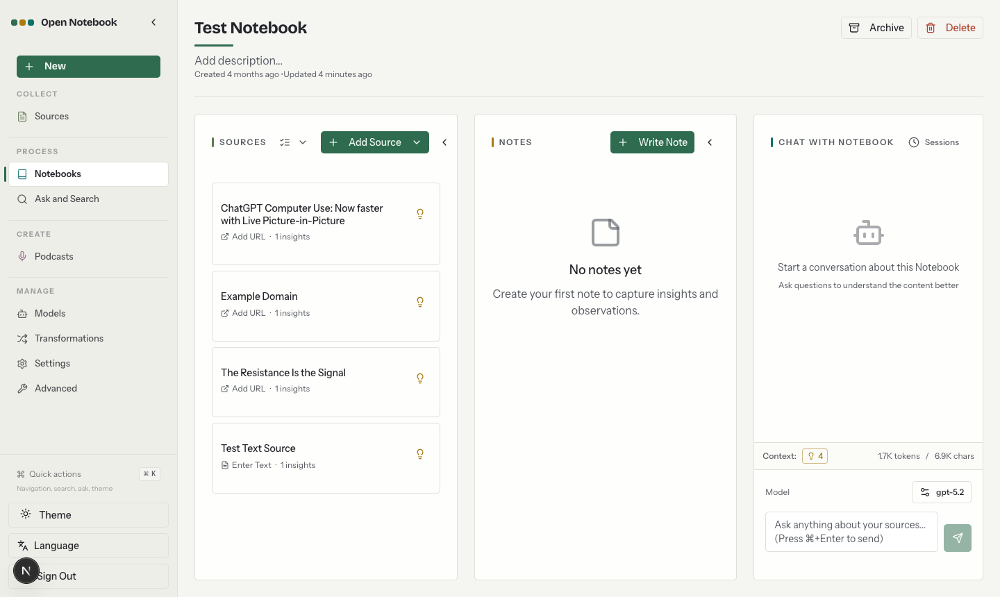

<!-- Hand-maintained translation of README.md as of commit f7e7067. Update this line when the translation is brought up to date. Kept by hand only while zdoc.app does not serve this language (#1550). -->
<a id="readme-top"></a>

<!-- [![Contributors][contributors-shield]][contributors-url] -->
[![Forks][forks-shield]][forks-url]
[![Stargazers][stars-shield]][stars-url]
[![Issues][issues-shield]][issues-url]
[![MIT License][license-shield]][license-url]
<!-- [![LinkedIn][linkedin-shield]][linkedin-url] -->


<!-- PROJECT LOGO -->
<br />
<div align="center">
  <a href="https://github.com/lfnovo/open-notebook">
    
  </a>

  <h3 align="center">Open Notebook</h3>

  <p align="center">
    Google Notebook LM'e açık kaynaklı ve gizlilik odaklı bir alternatif!
    <br /><strong>Yardım almak, iş akışı fikirlerini paylaşmak ve özellik önermek için <a href="https://discord.gg/37XJPXfz2w">Discord sunucumuza</a> katılın!</strong>
    <br />
    <a href="https://www.open-notebook.ai"><strong>Web sitemize göz atın »</strong></a>
    <br />
    Güncellemeler için X'te <a href="https://x.com/lfnovo">@lfnovo</a> hesabını takip edin
    <br />
    <br />
    <a href="../../0-START-HERE/index.md">📚 Başlarken</a>
    ·
    <a href="../../3-USER-GUIDE/index.md">📖 Kullanım Kılavuzu</a>
    ·
    <a href="../../2-CORE-CONCEPTS/index.md">✨ Özellikler</a>
    ·
    <a href="../../1-INSTALLATION/index.md">🚀 Kurulum</a>
  </p>
</div>

<p align="center">
<a href="https://trendshift.io/repositories/14536" target="_blank"></a>
</p>

<div align="center">
  <a href="../../../README.md">English</a> |
  <a href="https://zdoc.app/de/lfnovo/open-notebook">Deutsch</a> |
  <a href="https://zdoc.app/es/lfnovo/open-notebook">Español</a> |
  <a href="https://zdoc.app/fr/lfnovo/open-notebook">français</a> |
  <a href="https://zdoc.app/ja/lfnovo/open-notebook">日本語</a> |
  <a href="https://zdoc.app/ko/lfnovo/open-notebook">한국어</a> |
  <a href="https://zdoc.app/pt/lfnovo/open-notebook">Português</a> |
  <a href="https://zdoc.app/ru/lfnovo/open-notebook">Русский</a> |
  <a href="https://zdoc.app/zh/lfnovo/open-notebook">中文</a>
</div>

> 🇹🇷 Bu belge, İngilizce [README](../../../README.md) dosyasının `5e285b7` sürümünden çevrilmiştir. Güncel bilgi için İngilizce sürüme bakın.

## Gizlilik odaklı, çoklu model destekli, %100 yerel ve tam özellikli Notebook LM alternatifi



Yapay zekânın hâkim olduğu bir dünyada düşünebilmek 🧠 ve yeni bilgi edinebilmek 💡, birkaç kişiye ayrılmış bir ayrıcalık ya da tek bir sağlayıcıyla sınırlı bir yetenek olmamalıdır.

**Open Notebook ile şunları yapabilirsiniz:**
- 🔒 **Verilerinizin kontrolü sizde** - Araştırmalarınızı gizli ve güvende tutun
- 🤖 **Yapay zekâ modellerinizi seçin** - OpenAI, Anthropic, Google, Mistral, Ollama ve OpenAI uyumlu her sunucu (LM Studio, vLLM) dahil 20'den fazla sağlayıcı
- 📚 **Çok biçimli içerikleri düzenleyin** - PDF'ler, videolar, ses dosyaları, web sayfaları ve daha fazlası
- 🎙️ **Profesyonel podcast'ler üretin** - Gelişmiş, çok konuşmacılı podcast üretimi
- 🔍 **Akıllı arama yapın** - Tüm içeriğinizde tam metin ve vektör araması
- 💬 **Bağlamla sohbet edin** - Araştırmanızdan beslenen yapay zekâ sohbetleri
- 🌐 **Çok dilli arayüz** - İngilizce, Bengalce, Katalanca, Çince (Basitleştirilmiş ve Geleneksel), Fransızca, Almanca, İtalyanca, Japonca, Lehçe, Portekizce, Rusça, İspanyolca ve Türkçe

Projemiz hakkında daha fazla bilgi için: [https://www.open-notebook.ai](https://www.open-notebook.ai)

---

## 🆚 Open Notebook ve Google Notebook LM Karşılaştırması

| Özellik | Open Notebook | Google Notebook LM | Avantaj |
|---------|---------------|--------------------|-----------|
| **Gizlilik ve Kontrol** | Kendi sunucunuzda, verileriniz sizde | Yalnızca Google bulutu | Tam veri egemenliği |
| **Yapay Zekâ Sağlayıcı Seçimi** | Bulutta veya yerelde 20'den fazla sağlayıcı (OpenAI, Anthropic, Google, Ollama, LM Studio vb.) | Yalnızca Google modelleri | Esneklik ve maliyet optimizasyonu |
| **Podcast Konuşmacıları** | Özel profillerle 1-4 konuşmacı | Yalnızca 2 konuşmacı | Son derece esnek |
| **İçerik Dönüşümleri** | Özel ve yerleşik | Sınırlı seçenekler | Sınırsız işleme gücü |
| **API Erişimi** | Tam REST API | API yok | Tam otomasyon |
| **Dağıtım** | Docker, bulut veya yerel | Yalnızca Google barındırmalı | Her yerde çalıştırın |
| **Kaynak Gösterme** | Yanıtlar, kullandıkları kaynakları, notları ve içgörüleri gösterir | Kaynaklarla kapsamlı | Araştırma bütünlüğü |
| **Özelleştirme** | Açık kaynak, tamamen özelleştirilebilir | Kapalı sistem | Sınırsız genişletilebilirlik |
| **Maliyet** | Yalnızca yapay zekâ kullanımı için ödeme | Ücretsiz katman + Aylık abonelik | Şeffaf ve kontrol edilebilir |

**Neden Open Notebook?**
- 🔒 **Önce Gizlilik**: Kendi sunucunuzda çalışır; yerel modellerle hassas araştırmalarınız makinenizden çıkmaz
- 💰 **Maliyet Kontrolü**: Daha ucuz yapay zekâ sağlayıcıları seçin veya Ollama ile yerelde çalıştırın
- 🎙️ **Daha İyi Podcast'ler**: Sınırlı 2 konuşmacılı "deep-dive" biçimi yerine tam senaryo kontrolü ve çok konuşmacı esnekliği
- 🔧 **Sınırsız Özelleştirme**: İhtiyacınıza göre değiştirin, genişletin ve entegre edin
- 🌐 **Sağlayıcıya Bağımlılık Yok**: Sağlayıcı değiştirin, her yerde çalıştırın, verilerinizin sahibi olun

### Kullanılan Teknolojiler

[![Python][Python]][Python-url] [![Next.js][Next.js]][Next-url] [![React][React]][React-url] [![SurrealDB][SurrealDB]][SurrealDB-url] [![LangChain][LangChain]][LangChain-url]

## 🚀 Hızlı Başlangıç

### Gereksinimler
- [Docker Desktop](https://www.docker.com/products/docker-desktop/) (macOS, Windows) veya Compose eklentili Docker Engine (Linux)
- Bir yapay zekâ sağlayıcısından API anahtarı ya da Ollama gibi yerel bir model sunucusu. Anahtarı yapılandırma dosyalarına değil, arayüze eklersiniz.

### Adım 1: docker-compose.yml dosyasını indirin
```bash
mkdir open-notebook && cd open-notebook
curl -o docker-compose.yml https://raw.githubusercontent.com/lfnovo/open-notebook/main/docker-compose.yml
```

Bu, bu depodaki resmî [docker-compose.yml](../../../docker-compose.yml) dosyasıdır. İki servis çalıştırır: `surrealdb` (veritabanı) ve `open_notebook` (arayüz, API ve arka plan işçisi).

### Adım 2: Şifreleme anahtarınızı belirleyin
`docker-compose.yml` dosyasını düzenleyin ve şu satırı:
```yaml
- OPEN_NOTEBOOK_ENCRYPTION_KEY=change-me-to-a-secret-string
```
kendi oluşturduğunuz uzun ve rastgele bir gizli değerle değiştirin (örneğin `openssl rand -hex 32` ile; [diğer seçenekler](../../1-INSTALLATION/docker-compose.md#step-2-set-your-encryption-key)). Bu anahtar, kaydettiğiniz API anahtarlarını şifreler; onu saklayın.

> **Paylaşılan ağ veya sunucu mu?** Arayüz (`8502`) ve API (`5055`) tüm ağ arayüzlerinde yayınlanır ve varsayılan olarak parola yoktur. Başka cihazlar bu makineye erişebiliyorsa, başlatmadan önce bu iki port satırını `"127.0.0.1:8502:8502"` ve `"127.0.0.1:5055:5055"` olarak değiştirin ya da `environment:` bloğuna `- OPEN_NOTEBOOK_PASSWORD=your-password` ekleyin.

### Adım 3: Servisleri başlatın
```bash
docker compose up -d
```

Yaklaşık 30 saniye bekleyin, ardından şu adresi açın: **http://localhost:8502**

### Adım 4: Bir yapay zekâ sağlayıcısı bağlayın
1. Kenar çubuğunda **Manage** altında **Models** seçeneğini açın.
2. Sağlayıcınızı (OpenAI, Anthropic, Google vb.) bulun ve **Add Configuration** düğmesine tıklayın.
3. Bir ad ve API anahtarınızı girin (Ollama gibi yerel sağlayıcılar bunun yerine bir **Base URL** ister), ardından **Add Configuration** düğmesine tıklayın.
4. Bağlantıyı kontrol etmek için yeni yapılandırmada **Test** düğmesine tıklayın.
5. Aynı yapılandırmada **Models** düğmesine tıklayın; açılan **Discover Models** penceresinde bir **Model Type** seçin, eklemek istediğiniz modelleri işaretleyin ve **Add** düğmesine tıklayın. En az bir **Language** modeli ve bir **Embedding** modeli ekleyin.
6. **Default Model Assignments** altında **Auto-assign Defaults** düğmesine tıklayın (veya modelleri kendiniz seçin).

Hepsi bu! Bir not defteri oluşturun, bir kaynak ekleyin ve sohbete başlayın. Ayrıntılı anlatım: [Sağlayıcı bağlama](../../4-AI-PROVIDERS/index.md#connect-a-provider).

> **API anahtarına mı ihtiyacınız var?** Şuralardan alabilirsiniz:
> [OpenAI](https://platform.openai.com/api-keys) · [Anthropic](https://console.anthropic.com/settings/keys) · [Google](https://aistudio.google.com/app/apikey) · [Groq](https://console.groq.com/keys)
>
> Anthropic ve Groq'un embedding modeli yoktur; bunları embedding modeli sunan bir sağlayıcıyla birlikte kullanın ([matrise](#provider-support-matrix) bakın).

> **Ücretsiz yerel yapay zekâ mı istiyorsunuz?** [Yerel Hızlı Başlangıç](../../0-START-HERE/quick-start-local.md) kılavuzuna bakın (Docker'da Ollama).

---

### 📚 Diğer Kurulum Seçenekleri

- **[Ollama ile Yerel Yapay Zekâ](../../0-START-HERE/quick-start-local.md)** - Modelleri API maliyeti olmadan yerelde çalıştırın
- **[Docker Compose kılavuzu](../../1-INSTALLATION/docker-compose.md)** - Ayarlar, yedekler, güncellemeler, uzaktan erişim
- **[Kaynaktan Kurulum (Geliştiriciler)](../../1-INSTALLATION/from-source.md)** - Geliştirme ve katkı için
- **[Kapsamlı Kurulum Kılavuzu](../../1-INSTALLATION/index.md)** - Tüm dağıtım senaryoları

---

### 📖 Yardıma mı İhtiyacınız Var?

- **🤖 Yapay Zekâ Kurulum Asistanı**: [Kurulumda yardımcı olan CustomGPT](https://chatgpt.com/g/g-68776e2765b48191bd1bae3f30212631-open-notebook-installation-assistant)
- **🆘 Sorun Giderme**: [5 dakikalık sorun giderme kılavuzu](../../6-TROUBLESHOOTING/quick-fixes.md)
- **💬 Topluluk Desteği**: [Discord Sunucusu](https://discord.gg/37XJPXfz2w)
- **🐛 Sorun Bildirme**: [GitHub Issues](https://github.com/lfnovo/open-notebook/issues)

---

## Yıldız Geçmişi

[](https://star-history.dera.page/#lfnovo/open-notebook&type=date&legend=top-left)


<a id="provider-support-matrix"></a>
## Sağlayıcı Destek Matrisi

[Esperanto](https://github.com/lfnovo/esperanto) kütüphanesi sayesinde aşağıdaki sağlayıcıları kutudan çıktığı gibi destekliyoruz. Sütunlar, her sağlayıcının sunduğu model türlerini gösterir; neleri kullanabileceğiniz hesabınıza bağlıdır.

| Sağlayıcı    | LLM Desteği | Embedding Desteği | Konuşmadan Metne | Metinden Konuşmaya |
|--------------|-------------|------------------|----------------|----------------|
| OpenAI       | ✅          | ✅               | ✅             | ✅             |
| Anthropic    | ✅          | ❌               | ❌             | ❌             |
| Google (GenAI) | ✅          | ✅               | ✅             | ✅             |
| Groq         | ✅          | ❌               | ✅             | ❌             |
| Mistral      | ✅          | ✅               | ✅             | ✅             |
| DeepSeek     | ✅          | ❌               | ❌             | ❌             |
| xAI          | ✅          | ❌               | ❌             | ✅             |
| OpenRouter   | ✅          | ✅               | ✅             | ✅             |
| DashScope (Qwen) | ✅          | ❌               | ❌             | ❌             |
| MiniMax      | ✅          | ❌               | ❌             | ✅             |
| Novita       | ✅          | ❌               | ❌             | ❌             |
| SiliconFlow  | ✅          | ❌               | ❌             | ❌             |
| Z.ai         | ✅          | ❌               | ❌             | ❌             |
| PayPerQ (PPQ) | ✅          | ✅               | ✅             | ✅             |
| Cohere       | ✅          | ✅               | ❌             | ❌             |
| Voyage       | ❌          | ✅               | ❌             | ❌             |
| ElevenLabs   | ❌          | ❌               | ✅             | ✅             |
| Deepgram     | ❌          | ❌               | ✅             | ✅             |
| Ollama       | ✅          | ✅               | ❌             | ❌             |
| oMLX         | ✅          | ✅               | ❌             | ❌             |
| Azure OpenAI | ✅          | ✅               | ✅             | ✅             |
| Vertex AI    | ✅          | ✅               | ❌             | ✅             |
| OpenAI Compatible* | ✅          | ✅               | ✅             | ✅             |
| Anthropic Compatible | ✅          | ❌               | ❌             | ❌             |

*LM Studio'yu ve OpenAI uyumlu her uç noktayı destekler. [oMLX](https://omlx.ai/) (Apple Silicon) için yerel **oMLX** sağlayıcısını tercih edin; bkz. [docs/5-CONFIGURATION/omlx.md](../../5-CONFIGURATION/omlx.md).

## ✨ Temel Özellikler

### Ana Yetenekler
- **🔒 Önce Gizlilik**: Kendi sunucunuzda çalışır; model sunucusunu da (ör. Ollama) kendi donanımınızda çalıştırırsanız hiçbir veri makinenizden çıkmaz. Uzakta barındırılan OpenAI uyumlu uç noktalar birer bulut sağlayıcısıdır
- **🎯 Çoklu Not Defteri Düzeni**: Birden fazla araştırma projesini sorunsuzca yönetin
- **📚 Evrensel İçerik Desteği**: PDF'ler, videolar, ses dosyaları, web sayfaları, Office belgeleri ve daha fazlası
- **🤖 Çoklu Model Yapay Zekâ Desteği**: OpenAI, Anthropic, Ollama, Google, LM Studio ve daha fazlası dahil 20'den fazla sağlayıcı
- **🎙️ Profesyonel Podcast Üretimi**: Episode Profiles ile gelişmiş, çok konuşmacılı podcast'ler
- **🔍 Akıllı Arama**: Tüm içeriğinizde tam metin ve vektör araması
- **💬 Bağlama Duyarlı Sohbet**: Araştırma materyallerinizden beslenen yapay zekâ sohbetleri
- **📝 Yapay Zekâ Destekli Notlar**: İçgörüler üretin veya notları elle yazın

### Gelişmiş Özellikler
- **⚡ Akıl Yürütme Modeli Desteği**: DeepSeek-R1 ve Qwen3 gibi düşünen modeller için tam destek
- **🔧 İçerik Dönüşümleri**: Özetlemek ve içgörü çıkarmak için güçlü, özelleştirilebilir eylemler
- **🌐 Kapsamlı REST API**: Özel entegrasyonlar için tam programatik erişim [](http://localhost:5055/docs)
- **🔐 İsteğe Bağlı Parola Koruması**: Temel bir kimlik doğrulama katmanı ekler; herkese açık dağıtımları güvenceye almak için yalnızca buna güvenmeyin
- **📊 Ayrıntılı Bağlam Kontrolü**: Yapay zekâ modelleriyle tam olarak neyin paylaşılacağını seçin
- **📎 Kaynak Gösterme**: Kaynakları doğru şekilde gösterilmiş yanıtlar alın


## Podcast Özelliği

[](https://www.youtube.com/watch?v=D-760MlGwaI)

## 📚 Dokümantasyon

### Başlarken
- **[📖 Giriş](../../0-START-HERE/index.md)** - Open Notebook'un neler sunduğunu öğrenin
- **[⚡ Bulut Sağlayıcıyla Hızlı Başlangıç](../../0-START-HERE/quick-start-cloud.md)** - 5 dakikada OpenAI, Anthropic, Google ve daha fazlası
- **[🔧 Kurulum](../../1-INSTALLATION/index.md)** - Kapsamlı kurulum kılavuzu
- **[🎯 Tamamen Yerel Çalıştırın](../../0-START-HERE/quick-start-local.md)** - Ollama/LM Studio, tamamen gizli

### Kullanım Kılavuzu
- **[📱 Arayüze Genel Bakış](../../3-USER-GUIDE/interface-overview.md)** - Düzeni anlamak
- **[📚 Not Defterleri, Kaynaklar ve Notlar](../../2-CORE-CONCEPTS/notebooks-sources-notes.md)** - Araştırmanızı düzenlemek
- **[📄 Kaynak Ekleme](../../3-USER-GUIDE/adding-sources.md)** - İçerik türlerini yönetmek
- **[📝 Notlarla Çalışma](../../3-USER-GUIDE/working-with-notes.md)** - Not oluşturmak ve yönetmek
- **[💬 Etkili Sohbet](../../3-USER-GUIDE/chat-effectively.md)** - Yapay zekâ sohbetleri
- **[🔍 Arama](../../3-USER-GUIDE/search.md)** - Bilgi bulmak

### İleri Konular
- **[🎙️ Podcast Üretimi](../../2-CORE-CONCEPTS/podcasts-explained.md)** - Profesyonel podcast'ler oluşturun
- **[🔧 İçerik Dönüşümleri](../../3-USER-GUIDE/transformations.md)** - İçerik işlemeyi özelleştirin
- **[🤖 Yapay Zekâ Sağlayıcıları](../../4-AI-PROVIDERS/index.md)** - Sağlayıcıları bağlayın ve varsayılan modelleri belirleyin
- **[🔌 MCP Entegrasyonu](../../5-CONFIGURATION/mcp-integration.md)** - Claude Desktop, VS Code ve diğer MCP istemcileriyle bağlanın
- **[🔧 REST API Referansı](../../7-DEVELOPMENT/api-reference.md)** - Eksiksiz API dokümantasyonu
- **[🔐 Güvenlik](../../5-CONFIGURATION/security.md)** - Parola koruması ve gizlilik
- **[🚀 Dağıtım](../../1-INSTALLATION/index.md)** - Tüm senaryolar için eksiksiz dağıtım kılavuzları
- **[🧭 Vizyon ve İlkeler](../../../VISION.md)** - Open Notebook nedir ve nereye gidiyor
- **[🛠️ Geliştirici Dokümanları](../../7-DEVELOPMENT/index.md)** - Mimari, kurulum, katkı, karar kayıtları

<p align="right">(<a href="#readme-top">başa dön</a>)</p>

## 🗺️ Nereye Gidiyoruz

Şu anda odak noktamız, yeni ürün alanları eklemeden önce temel deneyimi (kaynaklar, sohbet, arama, notlar, podcast'ler) her sağlayıcıda ve her dağıtımda sağlam hâle getirmek. Çok kullanıcılı destek, yeni çıktı biçimleri ve Open Notebook'u MCP üzerinden kullanan ajanlar gibi değerlendirilmekte olan büyük yönelimler, [VISION.md](../../../VISION.md#horizon) dosyasının **Horizon** bölümünde anlatılmaktadır. Bunlar tarihli vaatler değil, yönelimlerdir.

Önerilen özellikler ve ürün fikirleri için [GitHub Discussions](https://github.com/lfnovo/open-notebook/discussions/categories/ideas) sayfasını, bilinen hatalar ve onaylanmış işler için [açık Issue'ları](https://github.com/lfnovo/open-notebook/issues) inceleyin. Son değişiklikler [CHANGELOG](../../../CHANGELOG.md) dosyasındadır.

<p align="right">(<a href="#readme-top">başa dön</a>)</p>


## 📖 Yardıma mı İhtiyacınız Var?
- **🤖 Yapay Zekâ Kurulum Asistanı**: [Open Notebook kurulumuna yardımcı olmak için hazırlanmış bir CustomGPT](https://chatgpt.com/g/g-68776e2765b48191bd1bae3f30212631-open-notebook-installation-assistant) var; sizi her adımda yönlendirecek!
- **Open Notebook'ta yeni misiniz?** [Başlangıç Kılavuzu](../../0-START-HERE/index.md) ile başlayın
- **Kurulum yardımı mı lazım?** [Kurulum Kılavuzu](../../1-INSTALLATION/index.md)'na göz atın
- **Nasıl çalıştığını görmek mi istiyorsunuz?** [Hızlı Başlangıç Eğitimi](../../0-START-HERE/quick-start-cloud.md)'ni deneyin

## 🤝 Topluluk ve Katkı

### Topluluğa Katılın
- 💬 **[Discord Sunucusu](https://discord.gg/37XJPXfz2w)** - Yardım alın, fikir paylaşın ve diğer kullanıcılarla tanışın
- 𝕏 **[X'te @lfnovo'yu takip edin](https://x.com/lfnovo)** - Proje sahibinden güncellemeler ve haberler
- 💡 **[GitHub Discussions](https://github.com/lfnovo/open-notebook/discussions)** - Soru sorun; özelliklere, ürün yönüne, tasarıma ve mimariye yön verin
- 🐛 **[GitHub Issues](https://github.com/lfnovo/open-notebook/issues)** - Tekrarlanabilir hataları bildirin ve onaylanmış işleri bulun
- ⭐ **Bu depoya yıldız verin** - Desteğinizi gösterin ve başkalarının Open Notebook'u keşfetmesine yardımcı olun

### Katkıda Bulunma
Katkılarınızı memnuniyetle karşılıyoruz! Özellikle şu konularda yardım arıyoruz:
- **Ön Yüz Geliştirme**: Modern Next.js/React arayüzümüzü geliştirmeye yardım edin
- **Test ve Hata Düzeltmeleri**: Open Notebook'u daha sağlam hâle getirin
- **Özellik Geliştirme**: En havalı araştırma aracını birlikte inşa edelim
- **Dokümantasyon**: Kılavuzları ve eğitimleri iyileştirin

**Mevcut Teknoloji Yığını**: Python, FastAPI, Next.js, React, SurrealDB

Nasıl başlayacağınıza dair ayrıntılı bilgi ve [yapay zekâ destekli katkılar](../../7-DEVELOPMENT/contributing.md#ai-assisted-and-agent-generated-prs) için yönergelerimiz [Katkı Kılavuzu](../../../CONTRIBUTING.md)'nda yer alıyor. Ne inşa ettiğimizi (ve neye hayır diyeceğimizi) anlamak için [VISION.md](../../../VISION.md) dosyasını okuyun.

<p align="right">(<a href="#readme-top">başa dön</a>)</p>


## 📄 Lisans

Open Notebook MIT lisanslıdır. Ayrıntılar için [LICENSE](../../../LICENSE) dosyasına bakın.


**Topluluk Desteği**:
- 💬 [Discord Sunucusu](https://discord.gg/37XJPXfz2w) - Yardım alın, fikir paylaşın ve kullanıcılarla tanışın
- 𝕏 [X'te @lfnovo'yu takip edin](https://x.com/lfnovo) - Proje sahibinden güncellemeler ve haberler
- 💡 [GitHub Discussions](https://github.com/lfnovo/open-notebook/discussions) - Soru sorun ve fikirlere yön verin
- 🐛 [GitHub Issues](https://github.com/lfnovo/open-notebook/issues) - Tekrarlanabilir hataları bildirin ve onaylanmış işleri bulun
- 🌐 [Web Sitesi](https://www.open-notebook.ai) - Proje hakkında daha fazla bilgi edinin

<p align="right">(<a href="#readme-top">başa dön</a>)</p>


<!-- MARKDOWN LINKS & IMAGES -->
<!-- https://www.markdownguide.org/basic-syntax/#reference-style-links -->
[contributors-shield]: https://img.shields.io/github/contributors/lfnovo/open-notebook.svg?style=for-the-badge
[contributors-url]: https://github.com/lfnovo/open-notebook/graphs/contributors
[forks-shield]: https://img.shields.io/github/forks/lfnovo/open-notebook.svg?style=for-the-badge
[forks-url]: https://github.com/lfnovo/open-notebook/network/members
[stars-shield]: https://img.shields.io/github/stars/lfnovo/open-notebook.svg?style=for-the-badge
[stars-url]: https://github.com/lfnovo/open-notebook/stargazers
[issues-shield]: https://img.shields.io/github/issues/lfnovo/open-notebook.svg?style=for-the-badge
[issues-url]: https://github.com/lfnovo/open-notebook/issues
[license-shield]: https://img.shields.io/github/license/lfnovo/open-notebook.svg?style=for-the-badge
[license-url]: https://github.com/lfnovo/open-notebook/blob/main/LICENSE
[linkedin-shield]: https://img.shields.io/badge/-LinkedIn-black.svg?style=for-the-badge&logo=linkedin&colorB=555
[linkedin-url]: https://linkedin.com/in/lfnovo
[Next.js]: https://img.shields.io/badge/Next.js-000000?style=for-the-badge&logo=next.js&logoColor=white
[Next-url]: https://nextjs.org/
[React]: https://img.shields.io/badge/React-61DAFB?style=for-the-badge&logo=react&logoColor=black
[React-url]: https://reactjs.org/
[Python]: https://img.shields.io/badge/Python-3776AB?style=for-the-badge&logo=python&logoColor=white
[Python-url]: https://www.python.org/
[LangChain]: https://img.shields.io/badge/LangChain-3A3A3A?style=for-the-badge&logo=chainlink&logoColor=white
[LangChain-url]: https://www.langchain.com/
[SurrealDB]: https://img.shields.io/badge/SurrealDB-FF5E00?style=for-the-badge&logo=databricks&logoColor=white
[SurrealDB-url]: https://surrealdb.com/
